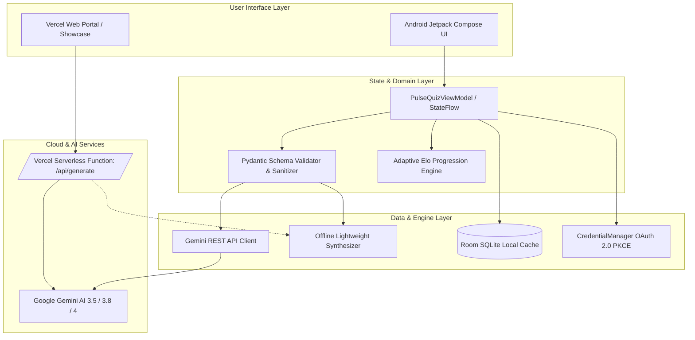

# PulseQuiz ⚡

> **Gamified Adaptive Learning & Competitive MCQ Platform**  
> Powered by Google Gemini AI, On-Device Lightweight Synthesis, Kotlin Jetpack Compose, and Vercel Cloud.

[](https://developer.android.com)
[](https://kotlinlang.org)
[](https://developer.android.com/jetpack/compose)
[](https://aistudio.google.com)
[](https://vercel.com)
[](LICENSE)

---

## 📖 Table of Contents

1. [Overview & Core Value](#-overview--core-value)
2. [Key Features](#-key-features)
3. [System Architecture](#-system-architecture)
4. [Environment Configuration (`.env`)](#-environment-configuration-env)
5. [Running the Android App](#-running-the-android-app)
6. [Deploying to Vercel](#-deploying-to-vercel)
7. [Gemini AI Models & Capabilities](#-gemini-ai-models--capabilities)
8. [Project Structure](#-project-structure)
9. [API Schema & Validation Contract](#-api-schema--validation-contract)
10. [Troubleshooting & FAQ](#-troubleshooting--faq)

---

## 🌟 Overview & Core Value

**PulseQuiz** is a curriculum-grade learning and trivia platform designed to eliminate login barriers and connectivity dead-ends. It combines **Google Gemini Generative AI** with an **On-Device Lightweight Synthesis Engine**, enabling rich multiple-choice question generation both online and 100% offline.

### Why PulseQuiz?
- **Zero-Login Anonymous Guest Usability**: Jump straight into adaptive study or competitive tournaments without mandatory sign-up walls.
- **Resilient Hybrid Architecture**: Seamlessly falls back to an embedded concept engine and local SQLite cache when network is unavailable.
- **Strict Pydantic-Grade Schema Validation**: Every generated MCQ guarantees 4 distinct choices, valid 0-based answer bounds, difficulty categorization, and deep conceptual explanations.
- **Cross-Platform Readiness**: Native Android app (Jetpack Compose) paired with a responsive web showcase and serverless API deployable to **Vercel** in seconds.

---

## 🚀 Key Features

### 1. Hybrid MCQ Generation Engine
- **Cloud Mode**: Streams schema-enforced structured JSON questions via Gemini models (`gemini-3.5-flash`), auto-caching every deck into Room SQLite.
- **Offline Mode**: Uses a deterministic rule-based template synthesizer and local question cache when offline or in airplane mode.

### 2. Four Comprehensive Knowledge Domains + Custom Topics
- 💻 **Computer Science, Programming & Tech**: Algorithms, Data Structures, Kotlin, Python/Pydantic, Distributed Systems, Cloud & OAuth 2.0 PKCE.
- 🧬 **General Knowledge, Science & Math**: Physics, Calculus, Linear Algebra, Astronomy, Genetics & World History.
- 🎯 **Competitive Exam Prep & Aptitude**: Quantitative arithmetic, syllogisms, permutations, speed-time-distance, and logical reasoning.
- 📚 **Language Learning & Vocabulary**: GRE/SAT etymology, Greek/Latin roots, grammatical precision, and semantic antonyms.
- ⚡ **Custom Topic Synthesis**: Type any subject prompt (e.g., "Kubernetes Pod Lifecycle", "Quantum Teleportation") to generate instant quizzes.

### 3. Adaptive Elo Mastery & Spaced Repetition
- Dynamically scales difficulty across 4 tiers:
  - **Tier 1 (Foundation)**: Core definitions & basic formulas.
  - **Tier 2 (Practitioner)**: Applied problem solving & standard analysis.
  - **Tier 3 (Specialist)**: Boundary trade-offs & complex reasoning.
  - **Tier 4 (Master)**: Multi-variable synthesis & edge-case proofs.
- **Weak-Topic Revision Deck**: Missed questions automatically enqueue into a spaced-repetition deck for targeted remediation.

### 4. Competitive Blitz & Head-to-Head Rooms
- **Timed Blitz Mode**: Rapid-fire rounds with combo streak multipliers (`1.5x`, `2.0x`, `3.0x`) and bonus time XP.
- **Head-to-Head / Pass-and-Play**: Challenge ghost rivals or compete locally in 2-player pass-and-play sessions.
- **Real-Time Leaderboards**: Filterable by Daily Tournament, All-Time XP, and Category Mastery.

### 5. Multi-User Guest Profiles & OAuth 2.0 PKCE Sync
- Multiple local guest profiles on a single device with distinct callsigns, avatars, streaks, and Elo ratings.
- Optional **Google Sign-In via Android Credential Manager** with OAuth 2.0 PKCE for cloud sync.

### 6. Socratic AI Study Mentor & Voice Transcription
- Multi-turn study chat with distinct tutor personas (Socratic Mentor, Blitz Coach, Schema Architect).
- Spoken voice query transcription powered by `gemini-3.5-transcribe` and `gemini-3.8-live`.

---

## 🏗️ System Architecture



---

## 🔑 Environment Configuration (`.env`)

PulseQuiz uses a `.env` file for managing API keys and secrets securely.

### 1. Create your `.env` file
The `.env` file is located in the root of the project:

```bash
# GEMINI_API_KEY: Required for Gemini AI API calls.
# Get your key at: https://aistudio.google.com/app/apikey
GEMINI_API_KEY=YOUR_GEMINI_API_KEY_HERE
```

> [!NOTE]
> For security, `.env` is listed in `.gitignore` and will never be committed to source control.

### 2. How the `.env` file is used:
- **Android Builds**: The `com.google.android.libraries.mapsplatform.secrets-gradle-plugin` automatically reads `.env` and exposes `BuildConfig.GEMINI_API_KEY` to Kotlin code.
- **Vercel Deployments**: The serverless `/api/generate.js` reads `process.env.GEMINI_API_KEY`. (Configure this under Vercel Project Settings → Environment Variables).

---

## 📱 Running the Android App

### Prerequisites
- **JDK**: Java 17 or Java 21
- **Android Studio**: Ladybug (2024.2.1) or newer
- **Android SDK**: Compile SDK `36`, Minimum SDK `24`

### Build Steps

1. **Clone or open the repository**:
   ```bash
   cd c:/Users/Admin/Downloads/quiz
   ```

2. **Ensure `.env` contains your Gemini API key**:
   ```bash
   # In .env:
   GEMINI_API_KEY=AIzaSy...
   ```

3. **Build the Debug APK**:
   ```bash
   ./gradlew assembleDebug
   ```
   The APK will be generated at:
   `app/build/outputs/apk/debug/app-debug.apk`

4. **Install on connected device / emulator**:
   ```bash
   ./gradlew installDebug
   ```

5. **Run Unit & Robolectric Tests**:
   ```bash
   ./gradlew test
   ```

---

## 🚀 Deploying to Vercel

PulseQuiz includes a **Vercel-ready Web Portal, Live Arena Demo, and Serverless API** (`/api/generate`) located in the root repository (`index.html`, `vercel.json`, `api/generate.js`).

### Method 1: Deploy via Vercel Dashboard (Recommended)

1. **Push your repository to GitHub / GitLab / Bitbucket**:
   ```bash
   git init
   git add .
   git commit -m "Initial commit of PulseQuiz"
   git remote add origin https://github.com/your-username/pulsequiz.git
   git push -u origin main
   ```

2. **Import into Vercel**:
   - Go to [vercel.com/new](https://vercel.com/new).
   - Select your `pulsequiz` repository.
   - Leave Framework Preset as **Other** (Vercel automatically detects the static site and `api/` serverless functions).

3. **Add Environment Variable**:
   - In the **Environment Variables** section:
     - **Key**: `GEMINI_API_KEY`
     - **Value**: Your Google AI Studio API key (`AIzaSy...`)
   - Click **Deploy**.

4. **Your web app is live!**  
   Vercel will provide an instant HTTPS URL (e.g., `https://pulsequiz.vercel.app`).

---

### Method 2: Deploy via Vercel CLI

1. **Install Vercel CLI** (if not already installed):
   ```bash
   npm install -g vercel
   ```

2. **Log in to Vercel**:
   ```bash
   vercel login
   ```

3. **Deploy with your environment variable**:
   ```bash
   vercel --env GEMINI_API_KEY=YOUR_GEMINI_API_KEY_HERE --prod
   ```

### What gets deployed to Vercel?
- 🌐 **Interactive Web Arena (`index.html`)**: Live web quiz with difficulty scaling, streak multipliers, sound/visual feedback, and responsive dark-mode styling.
- ⚡ **Serverless API (`/api/generate`)**: Edge-ready Node.js function proxying Gemini AI calls with built-in Pydantic schema validation and automatic offline synthesis fallback.

---

## 🤖 Gemini AI Models & Capabilities

| Model ID | Primary Responsibility in PulseQuiz | Fallback Model |
| :--- | :--- | :--- |
| `gemini-3.5-flash` | Structured JSON Multiple-Choice Question synthesis | `gemini-1.5-flash` |
| `gemini-3.8-flash` | Multi-turn Socratic Study Mentor and explanation engine | `gemini-3.5-flash` |
| `gemini-4-argon` | Deep STEM proofs, algorithmic analysis & schema design | `gemini-3.1-pro-preview` |
| `gemini-3.1-flash-lite` | Ultra-low-latency hints, definitions & flashcards | `gemini-3.1-flash-lite-preview` |
| `gemini-3.5-transcribe` | Real-time microphone audio transcription | `gemini-3.5-flash` |
| `gemini-3.8-live` | Interactive live voice conversational study sessions | — |

---

## 📂 Project Structure

```text
quiz/
├── .env                     # Local & build environment secrets (GEMINI_API_KEY)
├── .env.example             # Template for required environment variables
├── .gitignore               # Git exclusions (protects .env, build/, keystores)
├── vercel.json              # Vercel deployment routes and security headers
├── package.json             # Web metadata and local dev scripts
├── index.html               # Vercel Web Portal & Live Arena Demo
├── api/
│   └── generate.js          # Vercel Serverless Function (Gemini + Offline engine)
├── build.gradle.kts         # Root Gradle build script
├── settings.gradle.kts      # Gradle settings & plugin repositories
├── gradle.properties        # JVM & AndroidX build flags
├── gradle/
│   └── libs.versions.toml   # Centralized version catalog for dependencies
└── app/
    ├── build.gradle.kts     # Android module build script (Compose, Room, KSP)
    ├── proguard-rules.pro   # ProGuard / R8 code obfuscation & shrinking rules
    └── src/
        └── main/
            ├── AndroidManifest.xml
            ├── res/         # Drawables, mipmaps, fonts, colors
            └── java/com/example/
                ├── MainActivity.kt                 # Compose Root & Navigation
                ├── model/
                │   └── PulseModels.kt              # SubjectCategory, Tiers, PydanticMcqItem
                ├── domain/
                │   └── McqSchemaValidator.kt       # Pydantic schema validation & sanitization
                ├── data/
                │   ├── local/                      # Room Database, Entities, DAO
                │   ├── generator/                  # Gemini REST Service & Offline Engine
                │   ├── repository/                 # PulseRepository (Single Source of Truth)
                │   └── system/                     # Network observer, Audio, Notifications
                └── ui/
                    ├── PulseQuizViewModel.kt       # Reactive MVVM StateFlow Controller
                    ├── theme/                      # Electric Emerald & Deep Obsidian Theme
                    ├── components/                 # TopArenaBar, ProfileSheet, Dialogs
                    └── screens/
                        ├── ArenaHomeScreen.kt
                        ├── McqStudioScreen.kt
                        ├── QuizSessionScreen.kt
                        ├── AdaptiveMasteryScreen.kt
                        ├── RealTimeLeaderboardScreen.kt
                        ├── AiVoiceAndChatScreen.kt
                        └── SecurityAuditScreen.kt
```

---

## 📐 API Schema & Validation Contract

Every question generated by the AI or offline synthesizer satisfies the following JSON contract:

```json
{
  "question": "In Pydantic v2, which method is used to serialize a BaseModel into a dict?",
  "options": [
    "model_dump()",
    "to_dict_schema()",
    "serialize_json()",
    "export_fields()"
  ],
  "correctIndex": 0,
  "difficulty": 1,
  "subTopic": "Python & Pydantic Schema Design",
  "explanation": "Pydantic v2 replaced .dict() with .model_dump() for high-speed serialization.",
  "codeSnippet": "user = UserSchema(id=42)\npayload = user.model_dump()"
}
```

### Validation Invariants Enforced:
1. `options.size == 4`: Exactly 4 non-empty, distinct options.
2. `0 <= correctIndex <= 3`: Answer index within range.
3. `1 <= difficulty <= 4`: Normalized difficulty tier.
4. Input sanitization preventing script injection or malformed control characters.

---

## ❓ Troubleshooting & FAQ

### Q1: Can I test the app without a Gemini API Key?
**Yes!** PulseQuiz has a built-in **Offline Lightweight Concept Engine** that requires zero network connection and no API key. It generates schema-validated questions instantly.

### Q2: Why is my Gemini API Key not working in Android Studio?
1. Ensure your `.env` file exists in the root folder with `GEMINI_API_KEY=your_actual_key`.
2. Do not put quotes around the key in `.env`.
3. In Android Studio, click **File → Sync Project with Gradle Files** and rebuild.

### Q3: How do I test the Vercel web portal locally?
Run:
```bash
npx serve .
# Or if you have Vercel CLI:
vercel dev
```
Open `http://localhost:3000` in your browser.

---

## 📄 License

This project is licensed under the **MIT License**. Feel free to use, modify, and distribute.
